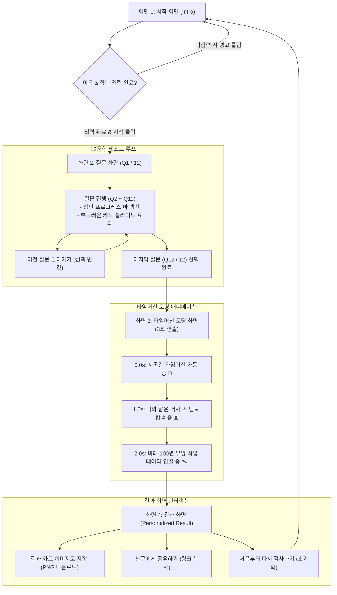

# 🚀 [초·중등 진로 탐색] 나만의 미래 직업 & 역사 롤모델 찾기 MBTI 테스트 기획서

---

## 📌 1. 콘텐츠 기획 개요

### 1.1 기획 배경 및 목적
- **자아 탐색의 첫걸음**: 초등 고학년(4~6학년)과 중학생은 '내가 무엇을 좋아하고 어떤 성향인지' 호기심이 폭발하는 시기입니다. 
- **친근한 언어로 재해석된 MBTI**: 기존 성인 중심의 딱딱한 성격 검사 용어(내향/외향, 직관/감각 등)를 배제하고, 학교·가정·친구 관계 등 일상 속 상황으로 자연스럽게 성향을 파악합니다.
- **미래 지향적 진로 교육**: 단순한 전통 직업(의사, 변호사, 공무원 등)을 넘어, 4차 산업혁명과 인류의 미래를 이끌 **유망 미래 직업**을 제안합니다.
- **역사 속 롤모델을 통한 성장 동기 부여**: 나와 동일한 성향을 가졌던 **국내·해외 역사 속 위인들의 삶과 명언**을 통해 "나도 멋진 사람이 될 수 있다"는 자존감과 꿈을 심어줍니다.

### 1.2 핵심 타깃 및 톤앤매너
| 구분 | 내용 |
| :--- | :--- |
| **대상 타깃** | 초등학교 4~6학년 및 중학교 1~3학년 (만 10세 ~ 15세) |
| **어휘 난이도** | 어려운 한자어(사유, 직관, 판단형 등) 완전 배제, 일상 구어체 및 초·중등 눈높이 어휘 사용 |
| **톤앤매너** | 친절하고 활기찬 코치/선생님 어투, 긍정적인 자기 효능감을 주는 칭찬 중심의 피드백 |
| **소요 시간** | 3~5분 내외 (총 12문항 2지선다형으로 높은 완주율 유도) |

---

## 📝 2. 테스트 문항 구성 (총 12문항)

검사는 **E/I (에너지 방향), S/N (인식 방식), T/F (판단 기준), J/P (생활 양식)** 4가지 영역을 각 3문항씩 측정합니다.

### 2.1 [E vs I] 에너지 충전 & 친구 관계 (문항 1~3)
> **E (신나는 탐험가 - 밖에서 친구들과 에너지를 얻어요)**  
> **I (차분한 생각쟁이 - 혼자만의 시간에서 힘을 얻어요)**

#### **Q1. 수업이 끝나고 기다리던 10분 쉬는 시간! 나는 보통 어떻게 시간을 보낼까?**
- **A (E):** "야, 복도로 나와!" 다른 반 친구들을 찾아가거나 운동장으로 달려가 왁자지껄 떠든다.
- **B (I):** 자리에서 조용히 좋아하는 만화책/소설을 보거나 단짝 친구와 도란도란 귓속말을 나눈다.

#### **Q2. 기다리던 토요일 아침! 주말을 가장 신나게 보내는 나의 방법은?**
- **A (E):** "오늘 뭐 해? 놀 사람 모여라!" 친구들에게 메신저를 보내 밖에서 신나게 만난다.
- **B (I):** 폭신한 내 방 침대에서 좋아하는 음악을 듣거나 취미를 즐기며 뒹굴거릴 때 제일 행복하다.

#### **Q3. 모둠 활동 시간, 선생님께서 "누가 모둠 결과를 앞에 나와서 발표해볼까?" 하실 때 나는?**
- **A (E):** "선생님, 제가 해볼게요!" 친구들 앞에서 내 생각을 뽐내는 게 재미있고 설렌다.
- **B (I):** '제발 내 이름 부르지 마세요…' 발표보다는 자료를 예쁘게 정리하고 꾸미는 역할이 훨씬 편하다.

---

### 2.2 [S vs N] 상상과 관찰 방식 (문항 4~6)
> **S (꼼꼼한 관찰자 - 눈앞의 현실과 생생한 사실을 봐요)**  
> **N (반짝이는 아이디어뱅크 - 무한한 상상과 가능성을 꿈꿔요)**

#### **Q4. 미술 시간, 선생님이 "자유 주제로 마음껏 멋진 작품을 만들어보세요!" 하셨을 때 나는?**
- **A (S):** 내 방 책상, 어제 먹은 떡볶이, 학교 풍경처럼 내가 실제로 보고 겪은 생생한 일을 자세히 그린다.
- **B (N):** 3020년 우주 정거장, 초능력 동물들이 사는 세상처럼 머릿속에만 있던 엉뚱하고 환상적인 세상을 그린다.

#### **Q5. 친구가 "야! 만약에 내일 아침 갑자기 지구에 중력이 사라지면 어떡하지?"라고 물어볼 때 나의 반응은?**
- **A (S):** "에이, 갑자기 중력이 왜 사라져? 과학적으로 말도 안 되는 소리 하지 마~"
- **B (N):** "대박! 그럼 이불 덮고 천장에 떠서 밥 먹어야 하나? 학교는 날아서 가겠네?!" 하며 상상을 펼친다.

#### **Q6. 새로 산 보드게임이나 신작 게임을 친구들과 처음 해볼 때 나는?**
- **A (S):** 상자에 들어 있는 게임 설명서나 튜토리얼을 1단계부터 꼼꼼히 읽고 규칙대로 시작한다.
- **B (N):** "일단 부딪쳐보자!" 게임하면서 나만의 기발한 필살기나 새로운 공략법을 본능적으로 찾아본다.

---

### 2.3 [T vs F] 고민 상담과 마음의 선택 (문항 7~9)
> **T (명쾌한 해결사 - 문제의 원인을 찾고 똑 부러지게 해결해요)**  
> **F (따뜻한 공감요정 - 친구의 마음에 깊이 귀 기울여줘요)**

#### **Q7. 단짝 친구가 열심히 준비한 줄넘기 급수 시험에서 떨어져서 눈물을 글썽일 때, 나의 첫마디는?**
- **A (T):** "발을 너무 높이 뛰어서 그래. 다음 주엔 줄 길이를 살짝 줄여서 연습해보자!"
- **B (F):** "아이고, 진짜 속상했겠다… 너 매일 연습했는데 억울하지? 토닥토닥, 괜찮아!"

#### **Q8. 모둠 숙제를 하다가 친구와 의견이 달라 말다툼이 생겼을 때, 내가 더 중요하게 여기는 것은?**
- **A (T):** "누구 말이 앞뒤가 맞고 올바른 사실인가?" 논리적으로 따져서 가장 효율적인 방법을 찾는 것.
- **B (F):** "친구 기분이 상하거나 모둠 분위기가 망가지진 않았나?" 서로 기분 상하지 않게 둥글게 푸는 것.

#### **Q9. 열심히 준비한 수행평가를 마치고 친구에게 들었을 때 날아갈 듯 기분 좋은 칭찬은?**
- **A (T):** "와! 내용 정리가 군더더기 없이 완벽하다. 너 진짜 똑똑하다!"
- **B (F):** "와! 너 이거 준비하느라 정말 고생 많았지? 정성이 듬뿍 느껴져 감동이야!"

---

### 2.4 [J vs P] 숙제와 생활 계획 (문항 10~12)
> **J (빈틈없는 계획왕 - 미리미리 시간표대로 착착 준비해요)**  
> **P (자유로운 탐험왕 - 상황에 맞춰 센스 있게 대처해요)**

#### **Q10. 여름방학 탐구 과제 제출 마감일이 일주일 앞으로 다가왔을 때 나의 모습은?**
- **A (J):** 매일 30분씩 나눠서 하는 계획표를 세우고, 마감 2~3일 전에 여유롭게 다 끝내놓는다.
- **B (P):** 마감 전날 밤 9시가 되었을 때 초인적인 집중력이 뿜어져 나와 번개처럼 끝낸다.

#### **Q11. 주말에 친구들과 테마파크나 놀이공원에 놀러 가기로 약속했을 때 나는?**
- **A (J):** 몇 시에 만나 어떤 놀이기구부터 탈지, 점심은 어디서 먹을지 미리 시간표를 짠다.
- **B (P):** "일단 1시에 정문에서 만나! 가보고 줄 짧은 거부터 타면 되지 뭐~" 발길 닿는 대로 즐긴다.

#### **Q12. 나의 책가방 안이나 공부 책상 위의 평소 모습은?**
- **A (J):** 과목별 교과서와 필기구가 칸칸이 바르게 정리되어 있어 언제든 필요한 걸 바로 찾는다.
- **B (P):** 언뜻 보기엔 어질러져 있어 보여도, 내 손만 뻗으면 어디 있는지 다 찾아내는 '나만의 보물창고'다.

---

## 🏆 3. 16개 MBTI 결과 프로필 데이터셋

---

### [1] ISTJ - 빈틈없는 원칙주의자
- **별명:** 든든한 약속 지킴이 탐정
- **한 줄 요약:** "내가 맡은 일은 끝까지 책임져! 약속과 규칙은 꼭 지키는 믿음직한 친구예요."
- **성향 분석:**
  - 차분하고 꼼꼼하며, 자신이 한 약속은 끝까지 지켜 친구와 선생님께 두터운 신뢰를 받습니다.
  - 정리 정돈을 잘하고 순서대로 차근차근 해내는 능력이 뛰어나 팀에서 가장 든든한 기둥 역할을 합니다.
  - *성장 팁:* 가끔은 예상치 못한 일이 일어나도 당황하지 말고 "그럴 수도 있지!" 하고 유연하게 넘겨보세요.
- **추천 미래 직업 (2개):**
  1. **스마트시티 인프라 관제사**: 미래 도시의 자율주행 도로, 신호등, 에너지 망이 안전하게 돌아가도록 24시간 철저히 모니터링하는 직업.
  2. **디지털 포렌식 사이버 수사관**: 해킹이나 디지털 범죄 사건에서 스마트폰과 컴퓨터의 데이터를 꼼꼼히 분석해 진실을 밝혀내는 데이터 탐정.
- **역사 속 롤모델:**
  - **국내 롤모델 - 충무공 이순신 (조선의 바다를 지킨 명장)**
    - *소개:* 철저한 준비와 원칙으로 난중일기를 기록하며 23전 23승 불패 신화를 쓴 위대한 장군.
    - *명언:* *"죽고자 하면 살 것이요, 살고자 하면 죽을 것이다."* (유비무환의 철저한 준비정신)
  - **해외 롤모델 - 조지 워싱턴 (미국의 초대 대통령)**
    - *소개:* 정직함과 규칙, 강한 책임감으로 혼란스러웠던 건국 초기 미국의 든든한 기반을 다진 지도자.
    - *명언:* *"원칙을 지키는 사람은 어떤 폭풍우 앞에서도 결코 흔들리지 않는다."*

---

### [2] ISFJ - 따뜻한 수호천사
- **별명:** 마음 따뜻한 수호천사
- **한 줄 요약:** "친구가 힘들 때 가장 먼저 손을 내미는 다정하고 성실한 배려왕이에요."
- **성향 분석:**
  - 친구들의 사소한 기분 변화도 잘 알아차리고, 묵묵히 뒤에서 챙겨주는 따뜻한 마음씨를 가졌습니다.
  - 조용하지만 맡은 일에 누구보다 끈기 있게 임하며 주변 사람들에게 편안함과 안도감을 줍니다.
  - *성장 팁:* 남을 배려하느라 내 마음이 다치지 않도록, 싫은 건 부드럽게 거절하는 연습도 필요해요.
- **추천 미래 직업 (2개):**
  1. **감성 케어 로봇 디자이너**: 아프거나 외로운 사람들의 마음을 따뜻하게 위로해주는 인공지능 돌봄 로봇의 성격과 대화법을 기획하는 전문가.
  2. **바이오 메디컬 코디네이터**: 미래 병원에서 유전자 맞춤형 치료를 받는 환자들의 건강과 심리 상태를 세심하게 돌보는 헬스케어 매니저.
- **역사 속 롤모델:**
  - **국내 롤모델 - 장기려 박사 (한국의 슈바이처)**
    - *소개:* 가난하고 아픈 사람들을 위해 평생을 바쳐 청십자병원을 세우고 헌신적인 인술을 베푼 참된 의사.
    - *명언:* *"사랑은 베풀수록 커지고, 다른 사람을 위해 살 때 가장 큰 행복을 느낀다."*
  - **해외 롤모델 - 플로렌스 나이팅게일 (근대 간호의 어머니)**
    - *소개:* 어두운 전쟁터 병동을 등불을 들고 밤새 돌보며, 철저한 위생 통계 시스템으로 수많은 생명을 살린 영웅.
    - *명언:* *"천사는 결코 화려한 날개를 달고 나타나지 않는다. 조용히 아픈 이를 감싸주는 손길 속에 있다."*

---

### [3] INFJ - 깊은 지혜의 등대
- **별명:** 세상을 바꾸는 비밀 꿈쟁이
- **한 줄 요약:** "조용하지만 마음속에 큰 꿈을 품고, 세상 모든 사람이 행복해지길 바라는 지혜로운 조언자예요."
- **성향 분석:**
  - 사람의 마음을 꿰뚫어 보는 통찰력이 뛰어나며, 친구들의 깊은 고민을 진심으로 들어줍니다.
  - 겉으로는 조용해 보이지만 세상의 불의를 참지 않고, 더 나은 세상을 만들기 위한 이상과 신념이 매우 뚜렷합니다.
  - *성장 팁:* 너무 완벽한 세상만 꿈꾸다 지치지 않도록, 가끔은 머리를 비우고 단순하게 쉬어가세요.
- **추천 미래 직업 (2개):**
  1. **윤리적 AI 가치관 설계사**: 인공지능이 인간에게 해를 끼치지 않고 모든 사람을 공평하고 따뜻하게 대하도록 윤리 기준을 프로그래밍하는 철학자.
  2. **지구 생태계 복원 전략가**: 기후 위기로 파괴된 숲과 바다를 첨단 생명공학 기술로 원래의 아름다운 모습으로 되살리는 환경 기획자.
- **역사 속 롤모델:**
  - **국내 롤모델 - 윤동주 (순수한 영혼을 노래한 민족시인)**
    - *소개:* 어두운 일제강점기 속에서도 한 점 부끄럼 없이 양심과 희망을 지키며 아름다운 시를 남긴 시인.
    - *명언:* *"잎새에 이는 바람에도 나는 괴로워했다. 죽는 날까지 하늘을 우러러 한 점 부끄럼이 없기를."*
  - **해외 롤모델 - 넬슨 만델라 (평화와 화해의 남아공 대통령)**
    - *소개:* 27년간의 감옥 생활 속에서도 용서와 평화의 신념을 잃지 않고 인종 차별을 없앤 인류의 스승.
    - *명언:* *"세상을 바꾸는 데 사용할 수 있는 가장 강력한 무기는 바로 교육이다."*

---

### [4] INTJ - 미래를 그리는 지략가
- **별명:** 똑똑한 미래 건축가
- **한 줄 요약:** "남들이 보지 못하는 10년 뒤를 내다보고 체계적으로 목표를 달성하는 전략가예요."
- **성향 분석:**
  - 지적 호기심이 매우 높고, 복잡한 문제도 원인을 파고들어 깔끔하게 정리해내는 논리적 사고의 천재입니다.
  - 목표가 생기면 빈틈없는 계획을 세워 혼자서도 끝까지 해내는 강한 의지력을 지녔습니다.
  - *성장 팁:* 친구들과 이야기할 때는 "왜 그렇게 생각해?"라고 따지기 전에 친구의 감정부터 한 번 살펴주세요.
- **추천 미래 직업 (2개):**
  1. **우주 궤도 탐사 플래너**: 화성과 달 기지를 건설하기 위해 우주선의 이동 경로와 물자 보급 전략을 정밀하게 시뮬레이션하는 우주 전략가.
  2. **양자 컴퓨터 알고리즘 개발자**: 슈퍼컴퓨터보다 수억 배 빠른 양자 컴퓨터를 이용해 신약과 신소재를 발명하는 첨단 소프트웨어 아키텍트.
- **역사 속 롤모델:**
  - **국내 롤모델 - 다산 정약용 (조선 후기 최고의 실학자)**
    - *소개:* 거중기를 발명해 수원화성을 짓고, 500여 권의 방대한 실학 서적으로 나라를 부강하게 만들려 했던 천재 지식인.
    - *명언:* *"배움이란 날마다 새로운 것을 깨달아 어제보다 더 나은 내가 되는 것이다."*
  - **해외 롤모델 - 니콜라 테슬라 (미래를 앞당긴 천재 과학자)**
    - *소개:* 교류 전기를 발명하고 무선 통신 기술을 예견하며 오늘날 첨단 문명의 청사진을 그린 위대한 발명가.
    - *명언:* *"현재는 그들의 것일지 모르지만, 내가 일해 온 미래는 바로 나의 것이다."*

---

### [5] ISTP - 만능 손재주 해결사
- **별명:** 뚝딱뚝딱 만능 해결사
- **한 줄 요약:** "조용히 지켜보다가 문제가 생기면 순식간에 뚝딱 해결해내는 쿨한 실력파예요."
- **성향 분석:**
  - 기계, 레고, 스마트폰 등 도구를 다루는 손재주와 감각이 매우 뛰어납니다.
  - 불필요한 말 대신 행동으로 보여주며, 위기 상황이나 돌발 변수가 생겼을 때 침착하게 문제를 해결합니다.
  - *성장 팁:* 혼자 척척 해내는 것도 멋지지만, 친구들에게 내 생각과 계획을 말로 자주 표현해주면 좋아요.
- **추천 미래 직업 (2개):**
  1. **도심항공교통(UAM) 기체 정비사**: 하늘을 나는 에어택시와 드론의 정밀 부품과 센서를 직접 점검하고 완벽하게 고쳐내는 미래 모빌리티 엔지니어.
  2. **재난대응 스마트 로봇 조종사**: 지진이나 화재 현장에 투입되는 첨단 인명 구조 로봇을 원격 조종하여 위험을 물리치는 테크 파일럿.
- **역사 속 롤모델:**
  - **국내 롤모델 - 장영실 (조선 최고의 천재 과학자)**
    - *소개:* 노비 출신이었으나 뛰어난 손재주와 관찰력으로 자격루(물시계), 측우기, 혼천의를 만들어 조선의 과학을 꽃피운 발명왕.
    - *명언:* *"손으로 만지고 눈으로 확인하여 이치를 밝혀내면 백성의 삶이 이로워진다."*
  - **해외 롤모델 - 라이트 형제 (인류 최초로 하늘을 난 비행기 발명가)**
    - *소개:* 수백 번의 추락과 기계 수리를 직접 반복하며 끝내 인류 역사상 최초로 동력 비행기를 띄운 실천파 형제.
    - *명언:* *"비행기를 만든 비결은 단 하나, 포기하지 않고 직접 고쳐 다시 날리는 것이었다."*

---

### [6] ISFP - 따뜻한 감성 예술가
- **별명:** 다정한 숲속 예술가
- **한 줄 요약:** "자연과 동물을 사랑하고, 나만의 감성을 그림과 음악으로 표현하는 따스한 친구예요."
- **성향 분석:**
  - 온화하고 다정하여 친구들과 다투지 않고 평화를 사랑하며, 주변 사람을 편안하게 해줍니다.
  - 뛰어난 미적 감각과 감수성을 지녀 예쁜 색감, 음악, 패션, 디자인에 탁월한 재능을 보입니다.
  - *성장 팁:* 속상한 일이 있을 때 혼자 꾹 참지 말고, 믿을 수 있는 가족이나 친구에게 솔직하게 털어놓아 보세요.
- **추천 미래 직업 (2개):**
  1. **메타버스 가상공간 아티스트**: 가상현실 속 환상적인 도시, 숲, 캐릭터를 감각적인 3D 그래픽으로 창작하는 디지털 공간 디자이너.
  2. **반려동물 교감 행동 심리사**: 말 못 하는 동물들의 표정과 몸짓을 세심하게 관찰하여 마음을 치료해주는 동물 복지 전문가.
- **역사 속 롤모델:**
  - **국내 롤모델 - 단원 김홍도 (조선의 삶을 그린 천재 화가)**
    - *소개:* 서민들의 일상과 자연의 아름다움을 따스하고 정겨운 붓 터치로 화폭에 담아낸 조선 최고의 풍속화가.
    - *명언:* *"참된 그림이란 마음으로 느끼는 정취를 붓끝에 자연스럽게 실어 보내는 것이다."*
  - **해외 롤모델 - 클로드 모네 (빛을 그린 인상파의 거장)**
    - *소개:* 시시각각 변하는 햇살과 꽃, 연못의 따스한 색채를 포착해 전 세계인의 마음을 치유하는 명작을 남긴 화가.
    - *명언:* *"나는 자연이 내게 보여주는 아름다운 색과 빛을 그대로 그리고 싶을 뿐이다."*

---

### [7] INFP - 별을 노래하는 몽상가
- **별명:** 별빛을 노래하는 이야기꾼
- **한 줄 요약:** "상상력이 풍부하고 마음이 깊어, 한 줄의 글과 그림으로도 감동을 주는 따뜻한 낭만파예요."
- **성향 분석:**
  - 순수하고 아름다운 가치관을 가지고 있으며, 마음속에 무한한 판타지 세계를 품고 살아갑니다.
  - 친구의 슬픔에 진심으로 눈물 흘려줄 줄 아는 깊은 공감 능력을 지녔으며, 글쓰기나 스토리 창작에 빛을 발합니다.
  - *성장 팁:* 머릿속의 멋진 상상들을 공책에 메모하고 작은 것부터 하나씩 행동으로 옮겨보세요!
- **추천 미래 직업 (2개):**
  1. **AI 프롬프트 스토리텔러**: 인공지능과 대화하며 감동적인 웹소설, 게임 시나리오, 영화 세계관을 만들어내는 차세대 이야기 작가.
  2. **버추얼 휴먼 캐릭터 브레인 기획자**: 가상 인간 아이돌이나 캐릭터가 독창적인 성격과 매력적인 서사를 갖도록 영혼을 불어넣는 창작자.
- **역사 속 롤모델:**
  - **국내 롤모델 - 백석 (마음의 별을 노래한 시인)**
    - *소개:* 토속적이고 따뜻한 우리말을 통해 외롭고 가난하지만 순결하고 높게 살아가는 삶의 아름다움을 노래한 시인.
    - *명언:* *"나는 이 세상에서 가장 가난하고 외롭고 높고 쓸쓸하게 살아가도록 태어났다."* (순수한 자아의 추구)
  - **해외 롤모델 - 앙투안 드 생텍쥐페리 ('어린 왕자'의 작가)**
    - *소개:* 비행기를 몰며 밤하늘의 별을 바라보고, 영원히 잊히지 않는 순수한 동화 '어린 왕자'를 쓴 파일럿 작가.
    - *명언:* *"가장 중요한 것은 눈에 보이지 않아. 오직 마음으로 보아야 진실을 볼 수 있단다."*

---

### [8] INTP - 물음표 가득한 호기심 박사
- **별명:** 물음표 가득한 호기심 박사
- **한 줄 요약:** "세상 모든 것의 원리가 궁금해! 끊임없이 질문하고 탐구하는 꼬마 아인슈타인이에요."
- **성향 분석:**
  - "이건 왜 그럴까?"라는 호기심이 끝이 없으며, 새로운 지식을 배우고 퍼즐을 푸는 것을 진심으로 즐깁니다.
  - 편견 없이 모든 현상을 논리적으로 분석하며, 남들이 생각하지 못한 독창적인 아이디어를 툭 던집니다.
  - *성장 팁:* 생각이 너무 깊어지면 행동이 늦어질 수 있어요. "일단 한번 해보자!" 하는 용기를 가져보세요.
- **추천 미래 직업 (2개):**
  1. **우주 천체 데이터 과학자**: 제임스웹 우주망원경이 보내오는 은하계 빅데이터를 분석해 미지의 외계 행성을 찾아내는 우주 탐험 연구원.
  2. **합성생물학 유전자 설계사**: 난치병을 치료하고 플라스틱을 분해하는 착한 미생물을 새롭게 디자인하는 미래 생명공학자.
- **역사 속 롤모델:**
  - **국내 롤모델 - 최석정 (세계 최초의 마방진을 만든 조선의 수학자)**
    - *소개:* 서양의 오일러보다 60년 앞서 9차 마방진(지수귀문도)을 고안해 낸 조선 최고의 수학 천재 영의정.
    - *명언:* *"수와 원리를 깊이 궁구하면 하늘과 땅의 모든 신비로운 이치에 닿을 수 있다."*
  - **해외 롤모델 - 알베르트 아인슈타인 (상대성 이론을 세운 물리학의 거인)**
    - *소개:* "빛을 타고 달리면 어떻게 될까?"라는 어린 시절의 엉뚱한 상상을 바탕으로 현대 물리학의 기틀을 바꾼 과학자.
    - *명언:* *"나는 특별한 재능이 있는 것이 아니다. 단지 미치도록 호기심이 많을 뿐이다."*

---

### [9] ESTP - 두려움 없는 번개 모험가
- **별명:** 번개처럼 빠른 모험 대장
- **한 줄 요약:** "고민은 짧게, 행동은 빠르게! 에너지가 넘치고 어떤 도전도 두려워하지 않는 행동파예요."
- **성향 분석:**
  - 운동신경과 순간 순발력이 뛰어나며, 새로운 환경이나 돌발 상황에서도 금방 적응해 분위기를 주도합니다.
  - 복잡한 이론 공부보다 직접 몸으로 체험하고 부딪쳐보는 실전에서 엄청난 잠재력을 폭발시킵니다.
  - *성장 팁:* 행동하기 전에 3초만 멈추고 "이 행동을 하면 다음엔 어떻게 될까?" 생각해보면 완벽해져요!
- **추천 미래 직업 (2개):**
  1. **익스트림 e스포츠 전술 코치**: 고도의 집중력과 동물적 반사신경으로 가상 스포츠 리그에서 승리를 이끄는 프로 감독.
  2. **우주 자원 채굴 파일럿**: 소행성에 착륙하여 첨단 드릴 로봇으로 희귀 금속을 캐내 지구로 운반하는 우주 개척 파일럿.
- **역사 속 롤모델:**
  - **국내 롤모델 - 광개토대왕 (대륙을 호령한 고구려의 정복 군주)**
    - *소개:* 두려움 없는 용기와 결단력으로 광활한 만주 벌판을 개척하며 고구려의 전성시대를 연 최고의 영웅.
    - *명언:* *"망설이지 말고 말을 달려라. 대륙의 끝까지 우리의 길을 개척할 것이다."*
  - **해외 롤모델 - 아멜리아 에어하트 (여성 최초로 대서양을 횡단한 비행사)**
    - *소개:* 거센 비바람과 두려움을 뚫고 단독 비행에 성공하며 전 세계 청소년들에게 불굴의 용기를 심어준 개척자.
    - *명언:* *"가장 어려운 것은 행동하겠다는 결정을 내리는 일이며, 그 나머지는 끈기일 뿐이다."*

---

### [10] ESFP - 반짝반짝 슈퍼스타
- **별명:** 반짝반짝 빛나는 슈퍼스타
- **한 줄 요약:** "내가 가는 곳이 곧 무대! 모두를 활짝 웃게 만드는 우리 반의 비타민이자 엔터테이너예요."
- **성향 분석:**
  - 유쾌하고 사교적이며, 함께 있는 사람들에게 긍정적인 에너지를 뿜어내 어디서나 인기가 많습니다.
  - 노래, 춤, 연기, 패션 등 사람들의 시선을 사로잡는 끼가 넘치며 현재의 순간을 온 마음으로 즐길 줄 압니다.
  - *성장 팁:* 재미있는 놀이도 좋지만, 내가 해야 할 숙제나 장기적인 목표도 잊지 않고 챙기는 멋진 습관을 길러보세요.
- **추천 미래 직업 (2개):**
  1. **실감형 미디어 인터랙티브 크리에이터**: 증강현실(AR)과 가상현실을 이용해 전 세계 팬들과 실시간으로 소통하는 차세대 크리에이터.
  2. **미래 테마파크 체험 디렉터**: 홀로그램과 인공지능이 가득한 미래형 놀이공원에서 관람객들에게 짜릿한 축제를 선사하는 연출가.
- **역사 속 롤모델:**
  - **국내 롤모델 - 바우덕이 (조선을 들썩이게 한 최초의 여성 꼭두쇠)**
    - *소개:* 남사당패를 이끌며 신명 나는 줄타기와 풍물놀이로 신분 차별에 지친 백성들의 눈물을 웃음으로 바꾼 천재 예인.
    - *명언:* *"내가 줄 위에 서서 신명 나게 놀 때, 사람들은 시름을 잊고 비로소 환하게 웃는다."*
  - **해외 롤모델 - 볼프강 아마데우스 모차르트 (음악의 신동)**
    - *소개:* 자유분방한 열정과 유쾌한 에너지로 온 세상을 매료시킨 불멸의 멜로디를 남긴 천재 작곡가.
    - *명언:* *"음악은 귀를 즐겁게 할 뿐만 아니라, 사람들의 마음에 가장 순수한 기쁨을 채워주는 빛이다."*

---

### [11] ENFP - 톡톡 튀는 비타민 탐험가
- **별명:** 톡톡 튀는 비타민 탐험가
- **한 줄 요약:** "머릿속에 재미있는 아이디어가 퐁퐁! 사람을 좋아하고 열정 가득한 모험가예요."
- **성향 분석:**
  - 밝고 에너지가 넘치며, 처음 만난 친구와도 5분 만에 단짝이 될 만큼 친화력이 무궁무진합니다.
  - 새로운 일에 도전하는 것을 두려워하지 않고, 기발하고 독창적인 아이디어로 사람들에게 즐거움을 선물합니다.
  - *성장 팁:* 시작한 일을 중간에 그만두지 않고 끝까지 마무리하는 끈기를 기르면 천하무적이 될 수 있어요!
- **추천 미래 직업 (2개):**
  1. **미래 우주여행 상품 기획자**: 달나라 무중력 캠프, 화성 노을 투어처럼 사람들의 가슴을 뛰게 하는 기발한 우주 관광 코스를 만드는 기획자.
  2. **소셜 임팩트 크라우드펀딩 디렉터**: 세상을 따뜻하게 바꾸는 친환경·나눔 아이디어를 전 세계 사람들에게 알리고 응원을 모으는 활동가.
- **역사 속 롤모델:**
  - **국내 롤모델 - 허균 (새로운 세상을 꿈꾼 조선의 혁신가)**
    - *소개:* 신분의 벽을 뛰어넘어 모두가 평등한 이상향 율도국을 그린 한글 소설 '홍길동전'을 지은 자유로운 영혼의 지식인.
    - *명언:* *"세상의 편견에 갇히지 마라. 새로운 생각과 따뜻한 마음이 세상을 바꾼다."*
  - **해외 롤모델 - 월트 디즈니 (꿈을 현실로 만든 마법사)**
    - *소개:* 미키 마우스와 디즈니랜드를 창조하여 상상력을 현실로 만들고 전 세계 아이들에게 꿈을 선물한 엔터테인먼트의 아버지.
    - *명언:* *"우리가 꿈을 꿀 수 있는 용기만 있다면, 그 모든 꿈은 반드시 현실이 된다."*

---

### [12] ENTP - 번뜩이는 아이디어 발명왕
- **별명:** 번뜩이는 아이디어 발명왕
- **한 줄 요약:** "기존의 틀을 깨는 짜릿함! 엉뚱한 질문과 재치 있는 말솜씨로 세상을 놀라게 해요."
- **성향 분석:**
  - 두뇌 회전이 엄청나게 빠르고 말솜씨가 뛰어나 토론 배틀에서 누구에게도 지지 않는 재간꾼입니다.
  - "왜 꼭 그렇게 해야 해?"라며 규칙에 얽매이지 않고 기발한 지름길을 찾아내는 혁신적인 마인드를 가졌습니다.
  - *성장 팁:* 토론할 때 상대방을 이기려고만 하지 말고, 상대방의 마음을 배려하며 부드럽게 설득해보세요.
- **추천 미래 직업 (2개):**
  1. **뇌-컴퓨터 인터페이스(BCI) 혁신가**: 생각만으로 로봇 팔을 움직이고 메타버스에 접속하는 첨단 뉴로테크놀로지를 개발하는 연구원.
  2. **스마트팜 바이오 스타트업 창업가**: 사막이나 도심 빌딩 안에서 인공지능으로 채소를 쑥쑥 키워 식량 문제를 해결하는 혁신 창업가.
- **역사 속 롤모델:**
  - **국내 롤모델 - 박제가 (조선의 벽을 깨뜨리려 한 개혁가)**
    - *소개:* '북학의'를 지어 우물 안 개구리였던 조선 사회에 무역과 신기술의 필요성을 역설한 당찬 실학자.
    - *명언:* *"우물물은 퍼 쓸수록 맑은 물이 솟아나듯, 지식과 재물도 널리 유통해야 백성이 부유해진다."*
  - **해외 롤모델 - 토머스 에디슨 (실패를 즐긴 위대한 발명왕)**
    - *소개:* 전구, 축음기 등 1,000가지가 넘는 발명품을 만들어 인류의 밤을 환하게 밝힌 지치지 않는 도전가.
    - *명언:* *"나는 실패한 적이 없다. 단지 잘 작동하지 않는 1만 가지 방법을 성공적으로 찾아냈을 뿐이다."*

---

### [13] ESTJ - 당당하고 멋진 리더
- **별명:** 당당하고 멋진 반장 리더
- **한 줄 요약:** "모두 날 따라와! 공정하고 명확한 규칙으로 팀을 승리로 이끄는 듬직한 대장이에요."
- **성향 분석:**
  - 책임감이 남다르고 추진력이 강해 학급 반장이나 동아리 회장 등 모임의 리더 역할을 도맡아 합니다.
  - 일의 순서를 착착 정하고 친구들의 역할을 똑 부러지게 배분해 어려운 과제도 일사천리로 해결합니다.
  - *성장 팁:* 계획대로 되지 않아 답답할 때도 친구들을 다그치기보다 "다들 수고했어!"라는 따뜻한 격려를 먼저 건네보세요.
- **추천 미래 직업 (2개):**
  1. **스마트 물류 자동화 총괄 관리자**: 자율주행 트럭, 물류 로봇, 드론 배송 시스템을 지휘하여 전 세계 물건을 가장 빠르고 정확하게 배송하는 총사령관.
  2. **기후위기 국가 안보 총괄관**: 홍수, 태풍 등 기후 재난으로부터 도시와 국민을 지키기 위한 방재 시스템과 법률을 정비하는 국가 리더.
- **역사 속 롤모델:**
  - **국내 롤모델 - 방촌 황희 (세종대왕을 보좌한 명재상)**
    - *소개:* 청렴결백한 성품과 엄격한 원칙, 공정한 판단력으로 조선 건국 초기 18년 동안 나라의 기틀과 제도를 완성한 재상.
    - *명언:* *"공적인 일에는 사사로운 정을 두지 말고, 오직 백성을 이롭게 하는 법과 원칙을 세워야 한다."*
  - **해외 롤모델 - 헨리 포드 (자동차 대중화를 이끈 혁신 경영자)**
    - *소개:* 컨베이어 벨트 조립 라인을 도입하여 자동차 생산의 시스템을 혁신하고 현대 산업 사회의 기틀을 마련한 경영인.
    - *명언:* *"함께 모이는 것은 시작이고, 함께 머무는 것은 진보이며, 함께 일하는 것은 성공이다."*

---

### [14] ESFJ - 다정다감한 모임의 중심
- **별명:** 모두를 챙기는 친절한 반장
- **한 줄 요약:** "소외되는 친구 없이 모두 사이좋게! 따뜻한 미소와 배려로 우리 반을 하나로 묶어줘요."
- **성향 분석:**
  - 인사성이 밝고 예의가 바르며, 주변 친구들의 사소한 경조사나 기념일까지 챙겨줄 만큼 정이 넘칩니다.
  - 갈등이 생기면 중간에서 부드럽게 중재하며, 친구들이 기뻐하는 모습을 보며 가장 큰 보람을 느낍니다.
  - *성장 팁:* 모든 사람에게 착한 사람으로 남으려 애쓰지 않아도 괜찮아요. 내 감정도 소중히 챙겨주세요!
- **추천 미래 직업 (2개):**
  1. **스마트 헬스케어 커뮤니티 매니저**: 원격 의료 시대에 환자와 의사를 잇고, 노인과 어린이들이 건강한 습관을 갖도록 따뜻하게 돕는 건강 멘토.
  2. **미래 교육 혁신 코디네이터**: 메타버스 교실과 AI 수업을 도입하는 학교에서 학생과 학부모, 선생님이 행복하게 소통하도록 돕는 교육 전문가.
- **역사 속 롤모델:**
  - **국내 롤모델 - 김만덕 (제주도를 살려낸 나눔의 의인)**
    - *소개:* 큰 장사로 모은 전 재산을 털어 극심한 흉년에 굶어 죽어가던 제주 백성 수만 명을 살려낸 위대한 나눔의 어머니.
    - *명언:* *"재물이란 모으는 것보다 베푸는 것이 어렵고, 베풂이야말로 진정으로 사람을 살리는 길이다."*
  - **해외 롤모델 - 엘리너 루스벨트 (세계인권선언을 이끈 미국의 퍼스트레이디)**
    - *소개:* 가난하고 억압받는 사람들을 찾아가 손을 맞잡고, UN 세계인권선언을 완성하여 전 세계에 평등과 사랑을 전한 인권 운동가.
    - *명언:* *"미래는 자신의 꿈의 아름다움을 굳게 믿는 사람들의 것이다."*

---

### [15] ENFJ - 희망을 밝히는 선한 등대
- **별명:** 희망을 꽃피우는 선한 등대
- **한 줄 요약:** "친구들의 꿈을 진심으로 응원해! 따뜻한 카리스마로 함께 더 나은 세상을 만들어요."
- **성향 분석:**
  - 친구들의 숨은 장점을 기가 막히게 찾아내어 칭찬해주고 용기를 불어넣어 주는 '꿈의 멘토'입니다.
  - 말과 행동에 진심이 담겨 있어 자연스럽게 사람들이 따르며, 모두가 행복해지는 일이라면 발 벗고 나섭니다.
  - *성장 팁:* 남들의 고민을 너무 내 일처럼 끌어안고 끙끙 앓지 않도록 마음의 경계선을 지켜주세요.
- **추천 미래 직업 (2개):**
  1. **청소년 미래 재능 매칭 디렉터**: 인공지능 시대 청소년들의 숨은 적성과 흥미를 발견해 미래 유망 직무와 1:1로 연결해주는 진로 멘토.
  2. **글로벌 기후평화 대사**: 기후 난민과 환경 문제를 해결하기 위해 세계 각국의 청소년들과 연대하고 희망의 캠페인을 이끄는 외교관.
- **역사 속 롤모델:**
  - **국내 롤모델 - 세종대왕 (백성을 진심으로 사랑한 위대한 성군)**
    - *소개:* 백성들이 글을 몰라 억울한 일을 당하지 않도록 신하들의 반대를 이겨내고 훈민정음을 창제한 인류 최고의 소통 군주.
    - *명언:* *"백성은 나라의 근본이니, 근본이 튼튼해야 나라가 평안해진다."* (애민정신)
  - **해외 롤모델 - 마틴 루터 킹 주니어 (꿈과 평화의 행진을 이끈 인권 목사)**
    - *소개:* 비폭력 평화 시위와 감동적인 연설로 피부색에 상관없이 모든 어린이가 손잡고 뛰노는 세상을 꿈꾸게 한 지도자.
    - *명언:* *"나에게는 꿈이 있습니다. 언젠가 내 아이들이 피부색이 아닌 인격으로 평가받는 나라에서 살게 되는 꿈입니다."*

---

### [16] ENTJ - 미래를 이끄는 당찬 총사령관
- **별명:** 미래를 이끄는 당찬 총사령관
- **한 줄 요약:** "원대한 비전을 세우고 반드시 이루어낸다! 당당한 자신감으로 미래를 개척하는 개척자예요."
- **성향 분석:**
  - 큰 그림을 보는 눈이 탁월하며, 아무리 어려운 목표라도 주저 없이 도전하여 성과를 내는 결단력이 있습니다.
  - 결단력과 통솔력이 뛰어나 어떤 모임에서도 중심에 서서 팀원들을 일사불란하게 이끌어갑니다.
  - *성장 팁:* 앞서 달릴 때 뒤처진 친구들의 손을 잡아주고, 친구들의 작은 의견도 귀담아듣는 여유를 가지면 최고의 영웅이 됩니다.
- **추천 미래 직업 (2개):**
  1. **우주 테라포밍 총괄 디렉터**: 달이나 화성에 인류가 거주할 수 있는 생태계 돔 도시를 건설하는 거대 프로젝트의 총책임자.
  2. **글로벌 AI 윤리기구 총괄 의장**: 전 세계 국가와 빅테크 기업들이 인공지능을 평화롭고 올바르게 사용하도록 국제 협약을 이끄는 리더.
- **역사 속 롤모델:**
  - **국내 롤모델 - 태조 왕건 (분열을 극복하고 고려를 세운 통합의 군주)**
    - *소개:* 후삼국의 혼란을 종식시키고 호족들을 포용하며 발해의 유민까지 끌어안아 진정한 민족 통일을 이룩한 위대한 지도자.
    - *명언:* *"원대한 뜻을 품고 화합을 도모하면, 어떤 거친 파도라도 능히 건널 수 있다."*
  - **해외 롤모델 - 율리우스 카이사르 (로마 제국의 기틀을 닦은 영웅)**
    - *소개:* 탁월한 전략과 용기, 결단력으로 로마를 세계적인 대제국으로 도약시키는 초석을 마련한 정치가이자 장군.
    - *명언:* *"주사위는 던져졌다. 왔노라, 보았노라, 이겼노라!"* (강력한 추진력과 결단)

---

## 💻 4. 프런트엔드 연동용 JSON 데이터셋

웹/앱 프런트엔드 애플리케이션(React, Vue, Vanilla JS 등)에서 곧바로 파싱하여 퀴즈 UI와 결과 뷰를 구현할 수 있도록 표준 JSON 규격으로 제공합니다.

```json
{
  "testMeta": {
    "title": "초·중학생 나만의 미래 직업 & 역사 롤모델 찾기 MBTI 진로 테스트",
    "target": "초등학교 4~6학년 및 중학생",
    "version": "1.0.0",
    "totalQuestions": 12
  },
  "questions": [
    {
      "id": 1,
      "dimension": "EI",
      "question": "수업이 끝나고 기다리던 10분 쉬는 시간! 나는 보통 어떻게 시간을 보낼까?",
      "options": [
        {
          "label": "A",
          "text": "\"야, 복도로 나와!\" 다른 반 친구들을 찾아가거나 운동장으로 달려가 왁자지껄 떠든다.",
          "score": "E"
        },
        {
          "label": "B",
          "text": "자리에서 조용히 좋아하는 만화책/소설을 보거나 단짝 친구와 도란도란 귓속말을 나눈다.",
          "score": "I"
        }
      ]
    },
    {
      "id": 2,
      "dimension": "EI",
      "question": "기다리던 토요일 아침! 주말을 가장 신나게 보내는 나의 방법은?",
      "options": [
        {
          "label": "A",
          "text": "\"오늘 뭐 해? 놀 사람 모여라!\" 친구들에게 메신저를 보내 밖에서 신나게 만난다.",
          "score": "E"
        },
        {
          "label": "B",
          "text": "폭신한 내 방 침대에서 좋아하는 음악을 듣거나 취미를 즐기며 뒹굴거릴 때 제일 행복하다.",
          "score": "I"
        }
      ]
    },
    {
      "id": 3,
      "dimension": "EI",
      "question": "모둠 활동 시간, 선생님께서 \"누가 모둠 결과를 앞에 나와서 발표해볼까?\" 하실 때 나는?",
      "options": [
        {
          "label": "A",
          "text": "\"선생님, 제가 해볼게요!\" 친구들 앞에서 내 생각을 뽐내는 게 재미있고 설렌다.",
          "score": "E"
        },
        {
          "label": "B",
          "text": "'제발 내 이름 부르지 마세요…' 발표보다는 자료를 예쁘게 정리하고 꾸미는 역할이 훨씬 편하다.",
          "score": "I"
        }
      ]
    },
    {
      "id": 4,
      "dimension": "SN",
      "question": "미술 시간, 선생님이 \"자유 주제로 마음껏 멋진 작품을 만들어보세요!\" 하셨을 때 나는?",
      "options": [
        {
          "label": "A",
          "text": "내 방 책상, 어제 먹은 떡볶이, 학교 풍경처럼 내가 실제로 보고 겪은 생생한 일을 자세히 그린다.",
          "score": "S"
        },
        {
          "label": "B",
          "text": "3020년 우주 정거장, 초능력 동물들이 사는 세상처럼 머릿속에만 있던 엉뚱하고 환상적인 세상을 그린다.",
          "score": "N"
        }
      ]
    },
    {
      "id": 5,
      "dimension": "SN",
      "question": "친구가 \"야! 만약에 내일 아침 갑자기 지구에 중력이 사라지면 어떡하지?\"라고 물어볼 때 나의 반응은?",
      "options": [
        {
          "label": "A",
          "text": "\"에이, 갑자기 중력이 왜 사라져? 과학적으로 말도 안 되는 소리 하지 마~\"",
          "score": "S"
        },
        {
          "label": "B",
          "text": "\"대박! 그럼 이불 덮고 천장에 떠서 밥 먹어야 하나? 학교는 날아서 가겠네?!\" 하며 상상을 펼친다.",
          "score": "N"
        }
      ]
    },
    {
      "id": 6,
      "dimension": "SN",
      "question": "새로 산 보드게임이나 신작 게임을 친구들과 처음 해볼 때 나는?",
      "options": [
        {
          "label": "A",
          "text": "상자에 들어 있는 게임 설명서나 튜토리얼을 1단계부터 꼼꼼히 읽고 규칙대로 시작한다.",
          "score": "S"
        },
        {
          "label": "B",
          "text": "\"일단 부딪쳐보자!\" 게임하면서 나만의 기발한 필살기나 새로운 공략법을 본능적으로 찾아본다.",
          "score": "N"
        }
      ]
    },
    {
      "id": 7,
      "dimension": "TF",
      "question": "단짝 친구가 열심히 준비한 줄넘기 급수 시험에서 떨어져서 눈물을 글썽일 때, 나의 첫마디는?",
      "options": [
        {
          "label": "A",
          "text": "\"발을 너무 높이 뛰어서 그래. 다음 주엔 줄 길이를 살짝 줄여서 연습해보자!\"",
          "score": "T"
        },
        {
          "label": "B",
          "text": "\"아이고, 진짜 속상했겠다… 너 매일 연습했는데 억울하지? 토닥토닥, 괜찮아!\"",
          "score": "F"
        }
      ]
    },
    {
      "id": 8,
      "dimension": "TF",
      "question": "모둠 숙제를 하다가 친구와 의견이 달라 말다툼이 생겼을 때, 내가 더 중요하게 여기는 것은?",
      "options": [
        {
          "label": "A",
          "text": "\"누구 말이 앞뒤가 맞고 올바른 사실인가?\" 논리적으로 따져서 가장 효율적인 방법을 찾는 것.",
          "score": "T"
        },
        {
          "label": "B",
          "text": "\"친구 기분이 상하거나 모둠 분위기가 망가지진 않았나?\" 서로 기분 상하지 않게 둥글게 푸는 것.",
          "score": "F"
        }
      ]
    },
    {
      "id": 9,
      "dimension": "TF",
      "question": "열심히 준비한 수행평가를 마치고 친구에게 들었을 때 날아갈 듯 기분 좋은 칭찬은?",
      "options": [
        {
          "label": "A",
          "text": "\"와! 내용 정리가 군더더기 없이 완벽하다. 너 진짜 똑똑하다!\"",
          "score": "T"
        },
        {
          "label": "B",
          "text": "\"와! 너 이거 준비하느라 정말 고생 많았지? 정성이 듬뿍 느껴져 감동이야!\"",
          "score": "F"
        }
      ]
    },
    {
      "id": 10,
      "dimension": "JP",
      "question": "여름방학 탐구 과제 제출 마감일이 일주일 앞으로 다가왔을 때 나의 모습은?",
      "options": [
        {
          "label": "A",
          "text": "매일 30분씩 나눠서 하는 계획표를 세우고, 마감 2~3일 전에 여유롭게 다 끝내놓는다.",
          "score": "J"
        },
        {
          "label": "B",
          "text": "마감 전날 밤 9시가 되었을 때 초인적인 집중력이 뿜어져 나와 번개처럼 끝낸다.",
          "score": "P"
        }
      ]
    },
    {
      "id": 11,
      "dimension": "JP",
      "question": "주말에 친구들과 테마파크나 놀이공원에 놀러 가기로 약속했을 때 나는?",
      "options": [
        {
          "label": "A",
          "text": "몇 시에 만나 어떤 놀이기구부터 탈지, 점심은 어디서 먹을지 미리 시간표를 짠다.",
          "score": "J"
        },
        {
          "label": "B",
          "text": "\"일단 1시에 정문에서 만나! 가보고 줄 짧은 거부터 타면 되지 뭐~\" 발길 닿는 대로 즐긴다.",
          "score": "P"
        }
      ]
    },
    {
      "id": 12,
      "dimension": "JP",
      "question": "나의 책가방 안이나 공부 책상 위의 평소 모습은?",
      "options": [
        {
          "label": "A",
          "text": "과목별 교과서와 필기구가 칸칸이 바르게 정리되어 있어 언제든 필요한 걸 바로 찾는다.",
          "score": "J"
        },
        {
          "label": "B",
          "text": "언뜻 보기엔 어질러져 있어 보여도, 내 손만 뻗으면 어디 있는지 다 찾아내는 '나만의 보물창고'다.",
          "score": "P"
        }
      ]
    }
  ],
  "results": {
    "ISTJ": {
      "type": "ISTJ",
      "nickname": "든든한 약속 지킴이 탐정",
      "headline": "내가 맡은 일은 끝까지 책임져! 약속과 규칙은 꼭 지키는 믿음직한 친구",
      "description": "차분하고 꼼꼼하며, 자신이 한 약속은 끝까지 지켜 친구와 선생님께 두터운 신뢰를 받습니다. 정리 정돈을 잘하고 순서대로 차근차근 해내는 능력이 뛰어나 팀에서 가장 든든한 기둥 역할을 합니다.",
      "growthTip": "가끔은 예상치 못한 일이 일어나도 당황하지 말고 '그럴 수도 있지!' 하고 유연하게 넘겨보세요.",
      "careers": [
        {
          "title": "스마트시티 인프라 관제사",
          "desc": "미래 도시의 자율주행 도로, 신호등, 에너지 망이 안전하게 돌아가도록 24시간 철저히 모니터링하는 직업"
        },
        {
          "title": "디지털 포렌식 사이버 수사관",
          "desc": "해킹이나 디지털 범죄 사건에서 스마트폰과 컴퓨터의 데이터를 꼼꼼히 분석해 진실을 밝혀내는 데이터 탐정"
        }
      ],
      "roleModels": {
        "domestic": {
          "name": "충무공 이순신",
          "title": "조선의 바다를 지킨 명장",
          "quote": "죽고자 하면 살 것이요, 살고자 하면 죽을 것이다.",
          "lesson": "철저한 준비(난중일기)와 규율, 꺾이지 않는 책임감으로 나라를 구했습니다."
        },
        "international": {
          "name": "조지 워싱턴",
          "title": "미국의 초대 대통령",
          "quote": "원칙을 지키는 사람은 어떤 폭풍우 앞에서도 결코 흔들리지 않는다.",
          "lesson": "정직함과 원칙, 흔들리지 않는 절제력으로 새로운 나라의 초석을 세웠습니다."
        }
      }
    },
    "ISFJ": {
      "type": "ISFJ",
      "nickname": "마음 따뜻한 수호천사",
      "headline": "친구가 힘들 때 가장 먼저 손을 내미는 다정하고 성실한 배려왕",
      "description": "친구들의 사소한 기분 변화도 잘 알아차리고, 묵묵히 뒤에서 챙겨주는 따뜻한 마음씨를 가졌습니다. 조용하지만 맡은 일에 누구보다 끈기 있게 임하며 주변 사람들에게 편안함과 안도감을 줍니다.",
      "growthTip": "남을 배려하느라 내 마음이 다치지 않도록, 싫은 건 부드럽게 거절하는 연습도 필요해요.",
      "careers": [
        {
          "title": "감성 케어 로봇 디자이너",
          "desc": "아프거나 외로운 사람들의 마음을 따뜻하게 위로해주는 AI 돌봄 로봇의 성격과 대화법을 기획하는 전문가"
        },
        {
          "title": "바이오 메디컬 코디네이터",
          "desc": "미래 병원에서 유전자 맞춤형 치료를 받는 환자들의 건강과 심리 상태를 세심하게 돌보는 헬스케어 매니저"
        }
      ],
      "roleModels": {
        "domestic": {
          "name": "장기려 박사",
          "title": "한국의 슈바이처",
          "quote": "사랑은 베풀수록 커지고, 다른 사람을 위해 살 때 가장 큰 행복을 느낀다.",
          "lesson": "평생 가난하고 아픈 이웃을 무료로 치료하며 따뜻한 나눔의 삶을 실천했습니다."
        },
        "international": {
          "name": "플로렌스 나이팅게일",
          "title": "근대 간호의 어머니",
          "quote": "천사는 결코 화려한 날개를 달고 나타나지 않는다. 조용히 아픈 이를 감싸주는 손길 속에 있다.",
          "lesson": "어두운 밤 등불을 들고 헌신적으로 부상병을 돌보며 현대 간호 체계를 세웠습니다."
        }
      }
    },
    "INFJ": {
      "type": "INFJ",
      "nickname": "세상을 바꾸는 비밀 꿈쟁이",
      "headline": "조용하지만 마음속에 큰 꿈을 품고, 세상의 평화를 바라는 지혜로운 조언자",
      "description": "사람의 마음을 꿰뚫어 보는 통찰력이 뛰어나며 친구들의 깊은 고민을 진심으로 들어줍니다. 겉으로는 조용해 보이지만 세상의 불의를 참지 않고, 더 나은 세상을 만들기 위한 이상과 신념이 뚜렷합니다.",
      "growthTip": "너무 완벽한 세상만 꿈꾸다 지치지 않도록, 가끔은 머리를 비우고 단순하게 쉬어가세요.",
      "careers": [
        {
          "title": "윤리적 AI 가치관 설계사",
          "desc": "인공지능이 인간에게 해를 끼치지 않고 모든 사람을 공평하고 따뜻하게 대하도록 윤리 기준을 세우는 철학자"
        },
        {
          "title": "지구 생태계 복원 전략가",
          "desc": "기후 위기로 파괴된 숲과 바다를 첨단 생명공학 기술로 원래의 아름다운 모습으로 되살리는 환경 기획자"
        }
      ],
      "roleModels": {
        "domestic": {
          "name": "윤동주",
          "title": "순수한 영혼을 노래한 민족시인",
          "quote": "잎새에 이는 바람에도 나는 괴로워했다. 죽는 날까지 하늘을 우러러 한 점 부끄럼이 없기를.",
          "lesson": "어두운 시대에도 맑고 순수한 영혼으로 시대의 아픔을 공감하고 양심을 지켰습니다."
        },
        "international": {
          "name": "넬슨 만델라",
          "title": "평화와 화해의 남아공 대통령",
          "quote": "세상을 바꾸는 데 사용할 수 있는 가장 강력한 무기는 바로 교육이다.",
          "lesson": "오랜 감옥 생활 속에서도 증오 대신 용서와 평화의 신념으로 인종 차별을 극복했습니다."
        }
      }
    },
    "INTJ": {
      "type": "INTJ",
      "nickname": "똑똑한 미래 건축가",
      "headline": "남들이 보지 못하는 10년 뒤를 내다보고 체계적으로 목표를 달성하는 전략가",
      "description": "지적 호기심이 매우 높고 복잡한 문제도 원인을 파고들어 깔끔하게 정리해내는 논리적 사고의 천재입니다. 목표가 생기면 빈틈없는 계획을 세워 혼자서도 끝까지 해내는 강한 의지력을 지녔습니다.",
      "growthTip": "친구들과 이야기할 때는 '왜 그렇게 생각해?'라고 따지기 전에 친구의 감정부터 한 번 살펴주세요.",
      "careers": [
        {
          "title": "우주 궤도 탐사 플래너",
          "desc": "화성과 달 기지를 건설하기 위해 우주선의 이동 경로와 물자 보급 전략을 정밀하게 시뮬레이션하는 우주 전략가"
        },
        {
          "title": "양자 컴퓨터 알고리즘 개발자",
          "desc": "슈퍼컴퓨터보다 수억 배 빠른 양자 컴퓨터를 이용해 신약과 신소재를 발명하는 첨단 소프트웨어 아키텍트"
        }
      ],
      "roleModels": {
        "domestic": {
          "name": "다산 정약용",
          "title": "조선 후기 최고의 실학자",
          "quote": "배움이란 날마다 새로운 것을 깨달아 어제보다 더 나은 내가 되는 것이다.",
          "lesson": "거중기를 발명하고 500여 권의 저술을 통해 조선 사회의 과학과 제도를 혁신했습니다."
        },
        "international": {
          "name": "니콜라 테슬라",
          "title": "미래를 앞당긴 천재 과학자",
          "quote": "현재는 그들의 것일지 모르지만, 내가 일해 온 미래는 바로 나의 것이다.",
          "lesson": "교류 전기와 무선 통신을 꿈꾸며 100년 앞선 상상력과 논리로 현대 문명을 설계했습니다."
        }
      }
    },
    "ISTP": {
      "type": "ISTP",
      "nickname": "뚝딱뚝딱 만능 해결사",
      "headline": "조용히 지켜보다가 문제가 생기면 순식간에 뚝딱 해결해내는 쿨한 실력파",
      "description": "기계, 도구, 전자기기를 다루는 손재주와 감각이 매우 뛰어납니다. 불필요한 말 대신 행동으로 보여주며, 위기 상황이나 돌발 변수가 생겼을 때 침착하게 문제를 해결합니다.",
      "growthTip": "혼자 척척 해내는 것도 멋지지만, 친구들에게 내 생각과 계획을 말로 자주 표현해주면 좋아요.",
      "careers": [
        {
          "title": "도심항공교통(UAM) 기체 정비사",
          "desc": "하늘을 나는 에어택시와 드론의 정밀 부품과 센서를 직접 점검하고 완벽하게 고쳐내는 미래 모빌리티 엔지니어"
        },
        {
          "title": "재난대응 스마트 로봇 조종사",
          "desc": "지진이나 화재 현장에 투입되는 첨단 인명 구조 로봇을 원격 조종하여 위험을 물리치는 테크 파일럿"
        }
      ],
      "roleModels": {
        "domestic": {
          "name": "장영실",
          "title": "조선 최고의 천재 과학자",
          "quote": "손으로 만지고 눈으로 확인하여 이치를 밝혀내면 백성의 삶이 이로워진다.",
          "lesson": "자격루, 측우기, 혼천의를 직접 고안하고 만들며 실용적인 기술로 세상을 바꿨습니다."
        },
        "international": {
          "name": "라이트 형제",
          "title": "인류 최초로 비행기를 띄운 형제",
          "quote": "비행기를 만든 비결은 단 하나, 포기하지 않고 직접 고쳐 다시 날리는 것이었다.",
          "lesson": "수백 번의 실패 속에서도 직접 부품을 깎고 조립하며 하늘을 나는 꿈을 이뤄냈습니다."
        }
      }
    },
    "ISFP": {
      "type": "ISFP",
      "nickname": "다정한 숲속 예술가",
      "headline": "자연과 동물을 사랑하고, 나만의 감성을 그림과 음악으로 표현하는 따스한 친구",
      "description": "온화하고 다정하여 친구들과 다투지 않고 평화를 사랑하며, 주변 사람을 편안하게 해줍니다. 뛰어난 미적 감각과 감수성을 지녀 예쁜 색감, 음악, 패션, 디자인에 탁월한 재능을 보입니다.",
      "growthTip": "속상한 일이 있을 때 혼자 꾹 참지 말고, 믿을 수 있는 가족이나 친구에게 솔직하게 털어놓아 보세요.",
      "careers": [
        {
          "title": "메타버스 가상공간 아티스트",
          "desc": "가상현실 속 환상적인 도시, 숲, 캐릭터를 감각적인 3D 그래픽으로 창작하는 디지털 공간 디자이너"
        },
        {
          "title": "반려동물 교감 행동 심리사",
          "desc": "말 못 하는 동물들의 표정과 몸짓을 세심하게 관찰하여 마음을 치료해주는 동물 복지 전문가"
        }
      ],
      "roleModels": {
        "domestic": {
          "name": "단원 김홍도",
          "title": "조선의 삶을 그린 천재 화가",
          "quote": "참된 그림이란 마음으로 느끼는 정취를 붓끝에 자연스럽게 실어 보내는 것이다.",
          "lesson": "서민들의 일상과 자연을 따뜻하고 정겨운 시선으로 화폭에 담아냈습니다."
        },
        "international": {
          "name": "클로드 모네",
          "title": "빛을 그린 인상파의 거장",
          "quote": "나는 자연이 내게 보여주는 아름다운 색과 빛을 그대로 그리고 싶을 뿐이다.",
          "lesson": "계절과 햇살에 따라 변하는 세상의 아름다운 찰나를 눈부신 캔버스로 탄생시켰습니다."
        }
      }
    },
    "INFP": {
      "type": "INFP",
      "nickname": "별빛을 노래하는 이야기꾼",
      "headline": "상상력이 풍부하고 마음이 깊어, 한 줄의 글과 그림으로도 감동을 주는 낭만파",
      "description": "순수하고 아름다운 가치관을 가지고 있으며, 마음속에 무한한 판타지 세계를 품고 살아갑니다. 친구의 슬픔에 진심으로 눈물 흘려줄 줄 아는 깊은 공감 능력을 지녔으며, 창작 활동에 빛을 발합니다.",
      "growthTip": "머릿속의 멋진 상상들을 공책에 메모하고 작은 것부터 하나씩 행동으로 옮겨보세요!",
      "careers": [
        {
          "title": "AI 프롬프트 스토리텔러",
          "desc": "인공지능과 대화하며 감동적인 웹소설, 게임 시나리오, 영화 세계관을 만들어내는 차세대 이야기 작가"
        },
        {
          "title": "버추얼 휴먼 캐릭터 브레인 기획자",
          "desc": "가상 인간 아이돌이나 캐릭터가 독창적인 성격과 매력적인 서사를 갖도록 영혼을 불어넣는 창작자"
        }
      ],
      "roleModels": {
        "domestic": {
          "name": "백석",
          "title": "마음의 별을 노래한 시인",
          "quote": "나는 이 세상에서 가장 가난하고 외롭고 높고 쓸쓸하게 살아가도록 태어났다.",
          "lesson": "가장 아름다운 우리말 시를 통해 순수한 영혼과 따뜻한 그리움을 노래했습니다."
        },
        "international": {
          "name": "앙투안 드 생텍쥐페리",
          "title": "'어린 왕자'의 작가",
          "quote": "가장 중요한 것은 눈에 보이지 않아. 오직 마음으로 보아야 진실을 볼 수 있단다.",
          "lesson": "밤하늘을 비행하며 어른들이 잊고 살았던 동심과 순수한 사랑의 가치를 전 세계에 남겼습니다."
        }
      }
    },
    "INTP": {
      "type": "INTP",
      "nickname": "물음표 가득한 호기심 박사",
      "headline": "세상 모든 것의 원리가 궁금해! 끊임없이 질문하고 탐구하는 꼬마 아인슈타인",
      "description": "'이건 왜 그럴까?'라는 호기심이 끝이 없으며, 새로운 지식을 배우고 퍼즐을 푸는 것을 진심으로 즐깁니다. 편견 없이 모든 현상을 논리적으로 분석하며, 남들이 생각하지 못한 독창적인 아이디어를 툭 던집니다.",
      "growthTip": "생각이 너무 깊어지면 행동이 늦어질 수 있어요. '일단 한번 해보자!' 하는 용기를 가져보세요.",
      "careers": [
        {
          "title": "우주 천체 데이터 과학자",
          "desc": "우주망원경이 보내오는 은하계 빅데이터를 분석해 미지의 외계 행성을 찾아내는 우주 탐험 연구원"
        },
        {
          "title": "합성생물학 유전자 설계사",
          "desc": "난치병을 치료하고 플라스틱을 분해하는 착한 미생물을 새롭게 디자인하는 미래 생명공학자"
        }
      ],
      "roleModels": {
        "domestic": {
          "name": "최석정",
          "title": "세계 최초 마방진을 만든 조선의 수학자",
          "quote": "수와 원리를 깊이 궁구하면 하늘과 땅의 모든 신비로운 이치에 닿을 수 있다.",
          "lesson": "서양보다 앞서 수학적 원리를 독창적으로 증명해내며 순수한 지적 탐구의 본보기를 보였습니다."
        },
        "international": {
          "name": "알베르트 아인슈타인",
          "title": "상대성 이론을 세운 물리학의 거인",
          "quote": "나는 특별한 재능이 있는 것이 아니다. 단지 미치도록 호기심이 많을 뿐이다.",
          "lesson": "빛을 따라가는 엉뚱한 상상력을 멈추지 않아 우주와 시간의 비밀을 밝혀냈습니다."
        }
      }
    },
    "ESTP": {
      "type": "ESTP",
      "nickname": "번개처럼 빠른 모험 대장",
      "headline": "고민은 짧게, 행동은 빠르게! 에너지가 넘치고 어떤 도전도 두려워하지 않는 행동파",
      "description": "운동신경과 순간 순발력이 뛰어나며, 새로운 환경이나 돌발 상황에서도 금방 적응해 분위기를 주도합니다. 복잡한 이론 공부보다 직접 몸으로 체험하고 부딪쳐보는 실전에서 엄청난 잠재력을 폭발시킵니다.",
      "growthTip": "행동하기 전에 3초만 멈추고 '이 행동을 하면 다음엔 어떻게 될까?' 생각해보면 완벽해져요!",
      "careers": [
        {
          "title": "익스트림 e스포츠 전술 코치",
          "desc": "고도의 집중력과 동물적 반사신경으로 가상 스포츠 리그에서 승리를 이끄는 프로 감독"
        },
        {
          "title": "우주 자원 채굴 파일럿",
          "desc": "소행성에 착륙하여 첨단 드릴 로봇으로 희귀 금속을 캐내 지구로 운반하는 우주 개척 파일럿"
        }
      ],
      "roleModels": {
        "domestic": {
          "name": "광개토대왕",
          "title": "대륙을 호령한 고구려의 정복 군주",
          "quote": "망설이지 말고 말을 달려라. 대륙의 끝까지 우리의 길을 개척할 것이다.",
          "lesson": "두려움 없는 용기와 결단력으로 광활한 영토를 개척하고 나라의 위상을 드높였습니다."
        },
        "international": {
          "name": "아멜리아 에어하트",
          "title": "여성 최초 대서양 횡단 비행사",
          "quote": "가장 어려운 것은 행동하겠다는 결정을 내리는 일이며, 그 나머지는 끈기일 뿐이다.",
          "lesson": "거센 비바람과 두려움을 뚫고 단독 비행에 성공하며 불굴의 개척정신을 증명했습니다."
        }
      }
    },
    "ESFP": {
      "type": "ESFP",
      "nickname": "반짝반짝 빛나는 슈퍼스타",
      "headline": "내가 가는 곳이 곧 무대! 모두를 활짝 웃게 만드는 우리 반의 비타민이자 엔터테이너",
      "description": "유쾌하고 사교적이며, 함께 있는 사람들에게 긍정적인 에너지를 뿜어내 어디서나 인기가 많습니다. 노래, 춤, 연기, 패션 등 사람들의 시선을 사로잡는 끼가 넘치며 현재의 순간을 온 마음으로 즐길 줄 압니다.",
      "growthTip": "재미있는 놀이도 좋지만, 내가 해야 할 숙제나 장기적인 목표도 잊지 않고 챙기는 멋진 습관을 길러보세요.",
      "careers": [
        {
          "title": "실감형 미디어 인터랙티브 크리에이터",
          "desc": "증강현실(AR)과 가상현실을 이용해 전 세계 팬들과 실시간으로 소통하는 차세대 크리에이터"
        },
        {
          "title": "미래 테마파크 체험 디렉터",
          "desc": "홀로그램과 AI가 가득한 미래형 놀이공원에서 관람객들에게 짜릿한 축제를 선사하는 연출가"
        }
      ],
      "roleModels": {
        "domestic": {
          "name": "바우덕이",
          "title": "조선을 들썩이게 한 최초의 여성 꼭두쇠",
          "quote": "내가 줄 위에 서서 신명 나게 놀 때, 사람들은 시름을 잊고 비로소 환하게 웃는다.",
          "lesson": "신명 나는 줄타기와 공연으로 백성들의 고단한 마음을 위로하고 큰 웃음을 선물했습니다."
        },
        "international": {
          "name": "볼프강 아마데우스 모차르트",
          "title": "음악의 신동",
          "quote": "음악은 귀를 즐겁게 할 뿐만 아니라, 사람들의 마음에 가장 순수한 기쁨을 채워주는 빛이다.",
          "lesson": "자유분방한 열정과 유쾌한 에너지로 온 세상을 매료시킨 불멸의 멜로디를 남겼습니다."
        }
      }
    },
    "ENFP": {
      "type": "ENFP",
      "nickname": "톡톡 튀는 비타민 탐험가",
      "headline": "머릿속에 재미있는 아이디어가 퐁퐁! 사람을 좋아하고 열정 가득한 모험가",
      "description": "밝고 에너지가 넘치며, 처음 만난 친구와도 5분 만에 단짝이 될 만큼 친화력이 무궁무진합니다. 새로운 일에 도전하는 것을 두려워하지 않고, 기발하고 독창적인 아이디어로 사람들에게 즐거움을 선물합니다.",
      "growthTip": "시작한 일을 중간에 그만두지 않고 끝까지 마무리하는 끈기를 기르면 천하무적이 될 수 있어요!",
      "careers": [
        {
          "title": "미래 우주여행 상품 기획자",
          "desc": "달나라 무중력 캠프, 화성 노을 투어처럼 사람들의 가슴을 뛰게 하는 기발한 우주 관광 코스를 만드는 기획자"
        },
        {
          "title": "소셜 임팩트 크라우드펀딩 디렉터",
          "desc": "세상을 따뜻하게 바꾸는 친환경·나눔 아이디어를 전 세계 사람들에게 알리고 응원을 모으는 활동가"
        }
      ],
      "roleModels": {
        "domestic": {
          "name": "허균",
          "title": "새로운 세상을 꿈꾼 조선의 혁신가",
          "quote": "세상의 편견에 갇히지 마라. 새로운 생각과 따뜻한 마음이 세상을 바꾼다.",
          "lesson": "차별 없는 세상을 꿈꾸며 한글 소설 '홍길동전'을 지어 자유로운 이상을 노래했습니다."
        },
        "international": {
          "name": "월트 디즈니",
          "title": "꿈을 현실로 만든 마법사",
          "quote": "우리가 꿈을 꿀 수 있는 용기만 있다면, 그 모든 꿈은 반드시 현실이 된다.",
          "lesson": "미키 마우스와 디즈니랜드를 창조하여 상상력을 현실로 만들고 전 세계에 꿈을 선물했습니다."
        }
      }
    },
    "ENTP": {
      "type": "ENTP",
      "nickname": "번뜩이는 아이디어 발명왕",
      "headline": "기존의 틀을 깨는 짜릿함! 엉뚱한 질문과 재치 있는 말솜씨로 세상을 놀라게 하는 발명가",
      "description": "두뇌 회전이 엄청나게 빠르고 말솜씨가 뛰어나 토론 배틀에서 누구에게도 지지 않는 재간꾼입니다. '왜 꼭 그렇게 해야 해?'라며 규칙에 얽매이지 않고 기발한 지름길을 찾아내는 혁신적인 마인드를 가졌습니다.",
      "growthTip": "토론할 때 상대방을 이기려고만 하지 말고, 상대방의 마음을 배려하며 부드럽게 설득해보세요.",
      "careers": [
        {
          "title": "뇌-컴퓨터 인터페이스(BCI) 혁신가",
          "desc": "생각만으로 로봇을 움직이고 가상세계에 접속하는 첨단 뉴로테크놀로지를 개발하는 연구원"
        },
        {
          "title": "스마트팜 바이오 스타트업 창업가",
          "desc": "도심 빌딩 안에서 인공지능으로 농작물을 자동으로 키워 식량 문제를 해결하는 혁신 창업가"
        }
      ],
      "roleModels": {
        "domestic": {
          "name": "박제가",
          "title": "조선의 벽을 깨뜨리려 한 개혁가",
          "quote": "우물물은 퍼 쓸수록 맑은 물이 솟아나듯, 지식과 재물도 널리 유통해야 백성이 부유해진다.",
          "lesson": "'북학의'를 통해 조선의 낡은 관습을 비판하고 새로운 문물과 기술의 도입을 외쳤습니다."
        },
        "international": {
          "name": "토머스 에디슨",
          "title": "실패를 즐긴 위대한 발명왕",
          "quote": "나는 실패한 적이 없다. 단지 잘 작동하지 않는 1만 가지 방법을 성공적으로 찾아냈을 뿐이다.",
          "lesson": "수많은 실패를 놀이처럼 즐기며 전구와 축음기 등 인류 문명을 바꾼 발명품을 쏟아냈습니다."
        }
      }
    },
    "ESTJ": {
      "type": "ESTJ",
      "nickname": "당당하고 멋진 반장 리더",
      "headline": "모두 날 따라와! 공정하고 명확한 규칙으로 팀을 승리로 이끄는 듬직한 대장",
      "description": "책임감이 남다르고 추진력이 강해 학급 반장이나 동아리 회장 등 모임의 리더 역할을 도맡아 합니다. 일의 순서를 착착 정하고 친구들의 역할을 똑 부러지게 배분해 어려운 과제도 일사천리로 해결합니다.",
      "growthTip": "계획대로 되지 않아 답답할 때도 친구들을 다그치기보다 '다들 수고했어!'라는 따뜻한 격려를 먼저 건네보세요.",
      "careers": [
        {
          "title": "스마트 물류 자동화 총괄 관리자",
          "desc": "자율주행 트럭, 물류 로봇, 드론 배송 시스템을 지휘하여 전 세계 물품을 빠르고 정확하게 배송하는 총사령관"
        },
        {
          "title": "기후위기 국가 안보 총괄관",
          "desc": "홍수, 태풍 등 기후 재난으로부터 도시와 국민을 지키기 위한 방재 시스템과 법률을 정비하는 국가 리더"
        }
      ],
      "roleModels": {
        "domestic": {
          "name": "방촌 황희",
          "title": "세종대왕을 보좌한 명재상",
          "quote": "공적인 일에는 사사로운 정을 두지 말고, 오직 백성을 이롭게 하는 법과 원칙을 세워야 한다.",
          "lesson": "청렴결백한 성품과 엄격한 원칙, 공정한 판단력으로 조선 건국 초기 18년 동안 나라의 기틀을 닦았습니다."
        },
        "international": {
          "name": "헨리 포드",
          "title": "자동차 대중화를 이끈 산업의 개척자",
          "quote": "함께 모이는 것은 시작이고, 함께 머무는 것은 진보이며, 함께 일하는 것은 성공이다.",
          "lesson": "체계적인 분업 생산 시스템을 개발하여 누구나 자동차를 탈 수 있는 시대를 열었습니다."
        }
      }
    },
    "ESFJ": {
      "type": "ESFJ",
      "nickname": "모두를 챙기는 친절한 반장",
      "headline": "소외되는 친구 없이 모두 사이좋게! 따뜻한 미소와 배려로 우리 반을 하나로 묶어주는 조화의 요정",
      "description": "인사성이 밝고 예의가 바르며, 주변 친구들의 사소한 경조사나 기념일까지 챙겨줄 만큼 정이 넘칩니다. 갈등이 생기면 중간에서 부드럽게 중재하며, 친구들이 기뻐하는 모습을 보며 가장 큰 보람을 느낍니다.",
      "growthTip": "모든 사람에게 착한 사람으로 남으려 애쓰지 않아도 괜찮아요. 내 감정도 소중히 챙겨주세요!",
      "careers": [
        {
          "title": "스마트 헬스케어 커뮤니티 매니저",
          "desc": "원격 의료 시대에 환자와 의사를 잇고, 노인과 어린이들이 건강한 습관을 갖도록 따뜻하게 돕는 건강 멘토"
        },
        {
          "title": "미래 교육 혁신 코디네이터",
          "desc": "메타버스 교실과 AI 수업을 도입하는 학교에서 학생과 학부모, 선생님이 행복하게 소통하도록 돕는 교육 전문가"
        }
      ],
      "roleModels": {
        "domestic": {
          "name": "김만덕",
          "title": "제주도를 살려낸 나눔의 의인",
          "quote": "재물이란 모으는 것보다 베푸는 것이 어렵고, 베풂이야말로 진정으로 사람을 살리는 길이다.",
          "lesson": "전 재산을 털어 굶주린 수만 명의 백성을 구하고 따뜻한 이웃 사랑의 참뜻을 보여주었습니다."
        },
        "international": {
          "name": "엘리너 루스벨트",
          "title": "세계인권선언을 이끈 퍼스트레이디",
          "quote": "미래는 자신의 꿈의 아름다움을 굳게 믿는 사람들의 것이다.",
          "lesson": "가장 소외된 사람들을 찾아가 목소리를 듣고, UN 세계인권선언을 이끌어낸 다정한 리더였습니다."
        }
      }
    },
    "ENFJ": {
      "type": "ENFJ",
      "nickname": "희망을 꽃피우는 선한 등대",
      "headline": "친구들의 꿈을 진심으로 응원해! 따뜻한 카리스마로 함께 더 나은 세상을 만드는 희망의 멘토",
      "description": "친구들의 숨은 장점을 기가 막히게 찾아내어 칭찬해주고 용기를 불어넣어 주는 '꿈의 멘토'입니다. 말과 행동에 진심이 담겨 있어 자연스럽게 사람들이 따르며, 모두가 행복해지는 일이라면 발 벗고 나섭니다.",
      "growthTip": "남들의 고민을 너무 내 일처럼 끌어안고 끙끙 앓지 않도록 마음의 경계선을 지켜주세요.",
      "careers": [
        {
          "title": "청소년 미래 재능 매칭 디렉터",
          "desc": "AI 시대 청소년들의 숨은 적성과 흥미를 발견해 미래 유망 직무와 1:1로 연결해주는 진로 멘토"
        },
        {
          "title": "글로벌 기후평화 대사",
          "desc": "기후 난민과 환경 문제를 해결하기 위해 세계 각국의 청소년들과 연대하고 희망의 캠페인을 이끄는 외교관"
        }
      ],
      "roleModels": {
        "domestic": {
          "name": "세종대왕",
          "title": "백성을 사랑한 위대한 성군",
          "quote": "백성은 나라의 근본이니, 근본이 튼튼해야 나라가 평안해진다.",
          "lesson": "글을 몰라 억울한 백성들을 지극히 사랑하는 마음으로 훈민정음을 창제한 소통의 리더였습니다."
        },
        "international": {
          "name": "마틴 루터 킹 주니어",
          "title": "꿈과 평화의 행진을 이끈 인권 운동가",
          "quote": "나에게는 꿈이 있습니다. 언젠가 내 아이들이 피부색이 아닌 인격으로 평가받는 나라에서 살게 되는 꿈입니다.",
          "lesson": "증오 대신 사랑과 비폭력 평화 행진으로 전 세계 사람들의 마음에 큰 울림을 주었습니다."
        }
      }
    },
    "ENTJ": {
      "type": "ENTJ",
      "nickname": "미래를 이끄는 당찬 총사령관",
      "headline": "원대한 비전을 세우고 반드시 이루어낸다! 당당한 자신감으로 미래를 개척하는 개척자",
      "description": "큰 그림을 보는 눈이 탁월하며, 아무리 어려운 목표라도 주저 없이 도전하여 성과를 내는 결단력이 있습니다. 통솔력이 뛰어나 어떤 모임에서도 중심에 서서 팀원들을 일사불란하게 이끌어갑니다.",
      "growthTip": "앞서 달릴 때 뒤처진 친구들의 손을 잡아주고, 친구들의 작은 의견도 귀담아듣는 여유를 가져보세요.",
      "careers": [
        {
          "title": "우주 테라포밍 총괄 디렉터",
          "desc": "달이나 화성에 인류가 거주할 수 있는 생태계 돔 도시를 건설하는 거대 프로젝트의 총책임자"
        },
        {
          "title": "글로벌 AI 윤리기구 총괄 의장",
          "desc": "전 세계 국가와 기업들이 인공지능을 평화롭고 올바르게 사용하도록 국제 협약을 이끄는 리더"
        }
      ],
      "roleModels": {
        "domestic": {
          "name": "태조 왕건",
          "title": "고려를 세운 통합의 군주",
          "quote": "원대한 뜻을 품고 화합을 도모하면, 어떤 거친 파도라도 능히 건널 수 있다.",
          "lesson": "분열된 시대를 끝내고 원대한 비전과 탁월한 포용력으로 나라를 하나로 통합했습니다."
        },
        "international": {
          "name": "율리우스 카이사르",
          "title": "로마 제국의 기틀을 닦은 영웅",
          "quote": "주사위는 던져졌다. 왔노라, 보았노라, 이겼노라!",
          "lesson": "과감한 결단력과 강력한 실행력으로 위기를 돌파하며 로마를 세계적 제국으로 이끌었습니다."
        }
      }
    }
  }
}
```

---

## 💡 5. 프런트엔드 개발 구현 가이드 (간단 로직 예시)

```javascript
// [MBTI 점수 계산 로직 예시]
function calculateMBTI(answers) {
  // answers = { 1: 'E', 2: 'I', 3: 'E', 4: 'S', ... }
  const counts = { E: 0, I: 0, S: 0, N: 0, T: 0, F: 0, J: 0, P: 0 };
  
  Object.values(answers).forEach(score => {
    if (counts[score] !== undefined) counts[score]++;
  });

  const mbti = 
    (counts.E >= counts.I ? 'E' : 'I') +
    (counts.S >= counts.N ? 'S' : 'N') +
    (counts.T >= counts.F ? 'T' : 'F') +
    (counts.J >= counts.P ? 'J' : 'P');

  return mbti; // e.g. "ENFP"
}
```

---

## 📱 6. 사용자 화면 흐름 (User Flow) 및 세부 와이어프레임

초·중학생 사용자의 몰입감을 극대화하기 위해 **"타임머신을 타고 떠나는 나의 미래 & 역사 탐험"** 세계관을 적용한 UI/UX 화면 흐름 및 와이어프레임을 정의합니다.

### 6.1 사용자 화면 흐름도 (Mermaid User Flow)



---

### 6.2 화면별 세부 와이어프레임 (Wireframe) 및 컴포넌트 명세

---

#### 🎬 [화면 1] 시작 화면 (Intro / Landing Screen)
- **콘셉트**: 신비로운 우주와 타임머신 포털 그래픽으로 탐험의 설렘을 유도
- **핵심 목표**: 테스트 목적 전달 및 맞춤형 결과 생성을 위한 최소 정보(이름, 학년) 수집

```text
┌────────────────────────────────────────────────────────┐
│  [ 헤더 ]  🌐 미래 직업 X 역사 멘토 MBTI 탐색기         │
├────────────────────────────────────────────────────────┤
│                                                        │
│                    🚀 ⏳ 🌌                            │
│           [ 타임머신 일러스트 & 펄스 애니메이션 ]         │
│                                                        │
│         "시공간을 넘어 나와 꼭 맞는 미래 직업과        │
│             역사 속 인생 멘토를 찾아보자!"             │
│                                                        │
│   ┌────────────────────────────────────────────────┐   │
│   │  👤 이름(또는 별명)을 적어줘:                    │   │
│   │  [ 홍길동                      ] (최대 6자)     │   │
│   ├────────────────────────────────────────────────┤   │
│   │  🎓 학년을 선택해줘:                            │   │
│   │  ( ) 초4   ( ) 초5   (•) 초6                       │   │
│   │  ( ) 중1   ( ) 중2   ( ) 중3                       │   │
│   └────────────────────────────────────────────────┘   │
│                                                        │
│            [ 🚀 시공간 탐험 출발하기! ]                │
│             ( 클릭 시 입력값 체크 후 Q1 이동 )         │
│                                                        │
│   ⏱️ 예상 소요 시간: 약 3분 (총 12문항 2지선다)        │
└────────────────────────────────────────────────────────┘
```

- **UI 컴포넌트 & 인터랙션 명세**:
  1. **이름 입력 필드**: 특수문자 제한, 미입력 후 출발 버튼 클릭 시 인풋 박스가 좌우로 흔들리는 `Shake` 애니메이션 및 "이름이나 별명을 입력해줘!" 툴팁 표시.
  2. **학년 선택 칩(Radio)**: 직관적인 버튼형 칩으로 한 번의 터치로 손쉽게 선택 가능.
  3. **CTA 시작 버튼**: 부드러운 그라데이션 글로우(Glow) 효과 및 마우스 오버 시 살짝 떠오르는 호버 인터랙션.

---

#### ❓ [화면 2] 질문 화면 (Question / Quiz Screen)
- **콘셉트**: 집중도 높은 단일 카드 뷰 + 빠른 진척도를 보여주는 게이지 바
- **핵심 목표**: 선택 피로도를 최소화하고 직관적으로 2지선다를 선택하도록 유도

```text
┌────────────────────────────────────────────────────────┐
│ [← 이전]          [  진행률: 25% (Q3/12)  ]             │
│ [████████░░░░░░░░░░░░░░░░░░░░░░░░░░░░░░░░░░░░░░░]       │
├────────────────────────────────────────────────────────┤
│                                                        │
│  [ STEP 1. 에너지 탐험 ]                                │
│                                                        │
│  Q3. 모둠 활동 시간, 선생님께서                        │
│      "누가 모둠 결과를 앞에 나와서 발표해볼까?"        │
│      하실 때 나의 솔직한 모습은?                       │
│                                                        │
│  ┌──────────────────────────────────────────────────┐  │
│  │  [선택지 A]                                      │  │
│  │  🙋 "선생님, 제가 해볼게요!"                      │  │
│  │  친구들 앞에서 내 생각을 뽐내는 게               │  │
│  │  재미있고 두근거려요!                            │  │
│  └──────────────────────────────────────────────────┘  │
│                                                        │
│  ┌──────────────────────────────────────────────────┐  │
│  │  [선택지 B]                                      │  │
│  │  🤫 '제발 내 이름 부르지 마세요…'                │  │
│  │  발표보다는 조용히 자료를 찾고 예쁘게 꾸미는      │  │
│  │  역할이 훨씬 마음 편해요!                        │  │
│  └──────────────────────────────────────────────────┘  │
│                                                        │
│  💡 마음에 더 가까운 쪽을 하나만 콕 눌러줘!            │
└────────────────────────────────────────────────────────┘
```

- **UI 컴포넌트 & 인터랙션 명세**:
  1. **상단 프로그레스 바**: 문항 진행 시마다 실시간으로 부드러운 너비 트랜지션 (`transition: width 0.3s ease`) 적용.
  2. **선택지 카드 인터랙션**:
     - 마우스 오버 / 터치 시: 카드가 살짝 위로 들리며 테두리가 강조됨 (`transform: translateY(-4px)`).
     - 클릭 시: 보라색/파란색 네온 테두리와 체크 아이콘이 즉시 켜진 뒤, 약 **0.35초 딜레이 후 다음 문항 카드가 우측에서 좌측으로 슬라이드 페이드인** 전환.
  3. **이전(←) 버튼**: 이전 문항으로 되돌아가 답변을 수정할 수 있어 실수 방지.

---

#### ⏳ [화면 3] 타임머신 로딩 화면 (Transition / Loading Screen)
- **콘셉트**: 12문항 답변 완료 후 지루할 틈 없이 결과에 대한 기대감을 높이는 타임머신 연출
- **소요 시간**: 약 3.0초 (자동 진행)

```text
┌────────────────────────────────────────────────────────┐
│                                                        │
│                                                        │
│                        ✨ 🌌 ✨                        │
│                     🌀 🚀 🌀                           │
│             [ 회전하는 시공간 웜홀 애니메이션 ]         │
│                                                        │
│                                                        │
│       "홍길동 탐험가의 성향 좌표를 분석하고 있어요!"   │
│                                                        │
│       ┌────────────────────────────────────────┐       │
│       │  [ 롤링 애니메이션 텍스트 (1초 간격 교체) ]│       │
│       │                                        │       │
│       │  📍 1. 시공간 타임머신 좌표 계산 중...  │       │
│       │  🔍 2. 나와 닮은 역사 속 멘토 찾는 중.. │       │
│       │  🛰️ 3. 미래 100년 유망 직업 연결 중... │       │
│       └────────────────────────────────────────┘       │
│                                                        │
│           [••••••••••••••••••••••••••••] 100%          │
│                                                        │
└────────────────────────────────────────────────────────┘
```

- **UI 컴포넌트 & 인터랙션 명세**:
  1. **회전 포털 그래픽**: CSS 키프레임 애니메이션을 이용한 나선형 웜홀 회전 및 반짝이는 별 파티클 효과.
  2. **순차 롤링 텍스트**: 3단계 문구가 페이드인-페이드아웃으로 부드럽게 교체되며 로딩 완료 즉시 결과 화면으로 자동 전환.

---

#### 🏆 [화면 4] 개인 맞춤형 결과 화면 (Personalized Result Screen)
- **콘셉트**: 학생 이름과 학년이 각인된 **"나만의 미래 탐험가 인증서 & 진로 리포트 카드"**
- **핵심 목표**: 성향 이해, 미래 직업 2종 및 역사 멘토 2인 탐색, SNS 공유 및 소장용 이미지 다운로드

```text
┌────────────────────────────────────────────────────────┐
│  [ 공유하기 🔗 ]   [ 인증서 다운로드 📥 ]   [ 다시하기 🔄 ]│
├────────────────────────────────────────────────────────┤
│                                                        │
│   🎖️ [초등 6학년 홍길동] 탐험가의 시공간 분석 결과       │
│                                                        │
│        ╔══════════════════════════════════════╗        │
│        ║  든든한 약속 지킴이 탐정 (ISTJ)       ║        │
│        ╚══════════════════════════════════════╝        │
│                                                        │
│   💬 "내가 맡은 일은 끝까지 책임져!                    │
│       약속과 규칙은 꼭 지키는 믿음직한 친구예요."      │
│                                                        │
│   ┌────────────────────────────────────────────────┐   │
│   │ 🔍 [홍길동 탐험가의 특별한 슈퍼 파워]           │   │
│   │ • 차분하고 꼼꼼해서 친구들과 선생님의 무한 신뢰!│   │
│   │ • 정리 정돈과 순서대로 척척 해내는 모둠의 기둥! │   │
│   │                                                │   │
│   │ 💡 [성장 꿀팁]                                 │   │
│   │ 가끔 계획대로 안 돼도 "그럴 수도 있지!" 하고     │   │
│   │ 쿨하게 넘겨보는 연습을 해봐요!                 │   │
│   └────────────────────────────────────────────────┘   │
│                                                        │
│   🚀 [홍길동 탐험가에게 딱 맞는 미래 직업 TOP 2]      │
│   ┌───────────────────────┬────────────────────────┐   │
│   │ 🌐 스마트시티 인프라  │ 🕵️ 디지털 포렌식      │   │
│   │    관제사             │    사이버 수사관       │   │
│   │ 자율주행 도로와 에너지│ 스마트폰 속 데이터를   │   │
│   │ 망을 지키는 관제탑 대장│ 분석하는 데이터 탐정   │   │
│   └───────────────────────┴────────────────────────┘   │
│                                                        │
│   🏛️ [시공간을 넘어 만난 나의 인생 멘토 2인]           │
│   ┌────────────────────────────────────────────────┐   │
│   │ 🇰🇷 [국내 멘토] 충무공 이순신 (조선의 바다 명장) │   │
│   │ 📜 "죽고자 하면 살 것이요, 살고자 하면 죽을    │   │
│   │     것이다."                                   │   │
│   │ ⭐ 배울 점: 철저한 유비무환 준비성과 책임감    │   │
│   ├────────────────────────────────────────────────┤   │
│   │ 🇺🇸 [해외 멘토] 조지 워싱턴 (미국의 초대 대통령)│   │
│   │ 📜 "원칙을 지키는 사람은 폭풍우 앞에서도 결코  │   │
│   │     흔들리지 않는다."                          │   │
│   │ ⭐ 배울 점: 정직함과 흔들리지 않는 원칙 준수   │   │
│   └────────────────────────────────────────────────┘   │
│                                                        │
│   ┌────────────────────────────────────────────────┐   │
│   │  [ 📥 결과 카드 이미지로 저장하기 (PNG) ]       │   │
│   │  [ 🔗 친구들에게 테스트 링크 공유하기 ]        │   │
│   │  [ 🔄 다른 친구 이름으로 다시 해보기 ]         │   │
│   └────────────────────────────────────────────────┘   │
│                                                        │
└────────────────────────────────────────────────────────┘
```

- **UI 컴포넌트 & 인터랙션 명세**:
  1. **개인화 타이틀 뱃지**: `[입력한 학년 + 이름] 탐험가` 형태로 렌더링되어 학생에게 '나만을 위한 보고서'라는 만족감 부여.
  2. **카드형 레이아웃 Grid**:
     - 모바일 화면에서는 1열 세로 스택, 태블릿/PC에서는 2열 카드 그리드로 유연하게 반응형 배치.
     - 직업 카드와 멘토 카드는 밝고 세련된 글래스모피즘(Glassmorphism) 테두리와 포인트 아이콘 적용.
  3. **이미지 저장 버튼 (핵심 기능)**:
     - `html2canvas` 라이브러리를 연동하여 결과 리포트 영역을 인스타그램/카카오톡 공유에 최적화된 고화질 카드 이미지(PNG)로 자동 캡처 후 기기 다운로드 제공.
  4. **공유 & 다시하기**:
     - Web Share API 및 클립보드 복사(`navigator.clipboard.writeText`)를 통해 친구들과 테스트 결과를 비교하고 자랑할 수 있도록 지원.
